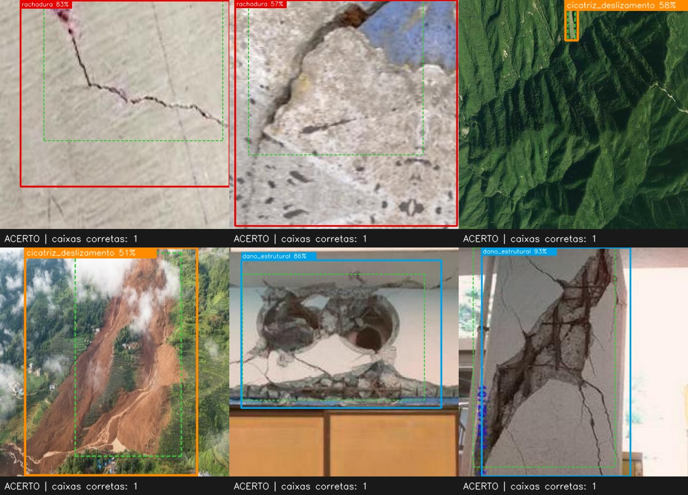
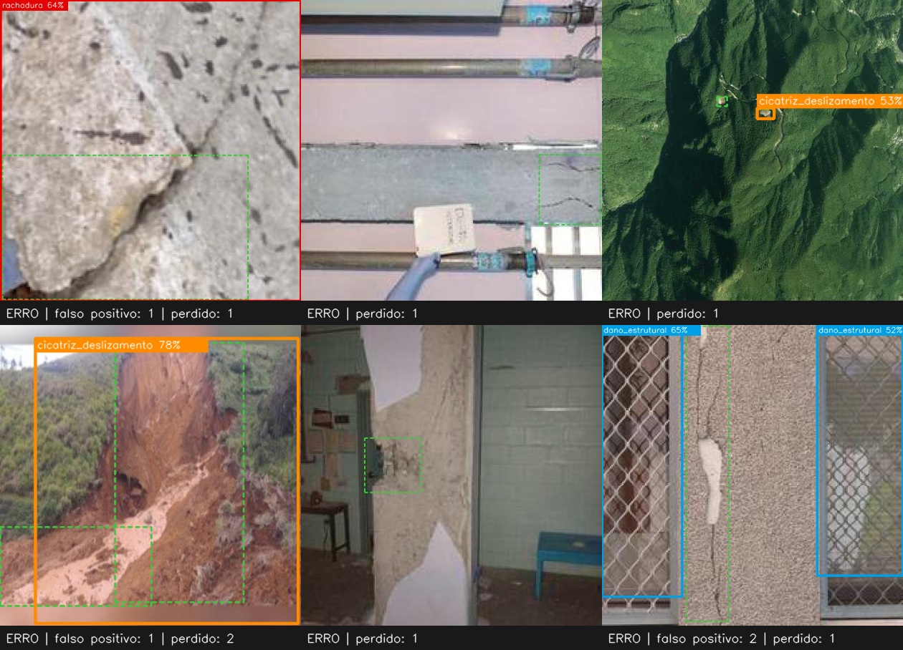
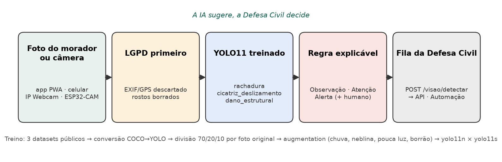

# Encosta Viva · Visão: detector de sinais de instabilidade de encosta

**FIAP · Global Solution 2026.2 · CitizenTech · Engenharia de Software 4º ano**
**Disciplina:** Applied Computer Vision · **Professores:** Arnaldo Viana e Paulo Rodrigues
**Atividade:** Enxergando o mundo real · **Papel no MVP:** componente **Visão** do produto **Encosta Viva**

> A IA sugere, a Defesa Civil decide. Em emergência, ligue **199** (Defesa Civil) ou **193** (Bombeiros).

O morador fotografa uma parede, um muro ou a encosta. Um **YOLO11 treinado por nós** marca o que pode indicar movimento do terreno (**rachadura**, **cicatriz de deslizamento** ou **dano estrutural grave**), e o relato vira um pedido de vistoria com evidência para a Defesa Civil. O detector roda **em tempo real** (webcam, câmera do celular ou vídeo) e por uma **API** integrada ao produto. Antes de qualquer análise, a foto passa pelo tratamento de LGPD: o GPS é apagado e os rostos são borrados.

| Entregável | Onde |
|---|---|
| Relatório PDF (título, integrantes, resumo, introdução, objetivo, ferramentas, metodologia, resultados, conclusão) | [`docs/Relatorio_Applied_Computer_Vision.pdf`](docs/Relatorio_Applied_Computer_Vision.pdf) |
| Vídeo de demonstração | <https://youtu.be/1sVGlOVufug> · feito em HyperFrames (projeto em [`video/`](video/)) |
| Código completo | este repositório |

---

## 1. Integrantes

| Nome completo | RM |
|---|---|
| Julio Cesar Zampieri | RM98772 |
| Ricardo Augusto de Matos Filho | RM95906 |
| João Gabriel Dias Nascimento | RM99092 |

## 2. Ficha Técnica do MVP

| Campo | Descrição |
|---|---|
| Nome do produto | Encosta Viva (componente: Visão) |
| Cidadão e território | Moradores de setores de risco alto e muito alto (R3/R4) em encostas urbanas (Grande SP, Litoral Norte, Petrópolis) e o agente da Defesa Civil municipal |
| Problema, em uma frase | Quem mora em encosta percebe os sinais primeiro, mas a Defesa Civil não tem olhos no terreno entre uma vistoria e outra |
| O que a Visão resolve | Transforma a foto do morador em evidência estruturada (classe, caixa, confiança) e sugere o nível de risco do setor, com explicação |
| Modelo de IA | **YOLO11n** treinado sob medida (transfer learning a partir do COCO), comparado com o YOLO11s |
| Classes | `rachadura` · `cicatriz_deslizamento` · `dano_estrutural` |
| Dados | 3 datasets públicos e abertos (CC BY 4.0 e MIT): 1.393 imagens originais e 274 cópias aumentadas |
| Integração | `POST /visao/detectar` (FastAPI), consumido pela API principal (`POST /relatos`) e pela Automação (fila de vistorias) |
| ODS | 11 (meta 11.5), 13 (meta 13.1), 9, 10 e 3 |

## 3. Resultados em uma página

Conjunto de **teste** (141 imagens nunca vistas no treino nem na escolha do checkpoint):

| Métrica (teste) | **yolo11n (escolhido)** | yolo11s |
|---|---|---|
| Precisão | **0,815** | 0,701 |
| Recall | 0,597 | **0,655** |
| mAP@50 | 0,699 | 0,706 |
| mAP@50-95 | **0,412** | 0,388 |
| FPS GPU (RTX 3050, 640 px) | ~70 | ~70 |
| FPS CPU (640 px) | **~27** | ~13 |
| Tamanho | **5,5 MB** | 19,2 MB |

| Classe (yolo11n) | Precisão | Recall | mAP@50 | mAP@50-95 |
|---|---|---|---|---|
| rachadura | 0,937 | 0,749 | 0,880 | 0,530 |
| cicatriz_deslizamento | 0,659 | 0,375 | 0,469 | 0,244 |
| dano_estrutural | 0,848 | 0,667 | 0,747 | 0,462 |

- **Por que o n:** o modelo 4x maior empatou em mAP@50 e perdeu em mAP@50-95 e precisão. Com os dados atuais, o próximo ganho vem de **dados**, não de arquitetura. O n também roda com o dobro de FPS em CPU.
- **Tempo real ponta a ponta** (borrão de rosto + detecção + regra, quadros de 960 px): **~26 FPS** na RTX 3050.
- **API:** ~17 ms de inferência por foto (o modelo é aquecido quando o servidor sobe).
- Números completos: [`avaliacao/metricas.json`](avaliacao/metricas.json), [`avaliacao/comparacao.md`](avaliacao/comparacao.md) e [`avaliacao/analise_erros.json`](avaliacao/analise_erros.json).

| Acertos no teste | Erros reais no teste |
|---|---|
|  |  |

Verde tracejado = gabarito; caixa colorida = predição. Os erros mais comuns são juntas de reboco e sombras confundidas com rachadura, grades de janela confundidas com dano estrutural e cicatrizes pequenas em fotos aéreas que não são detectadas. As correções propostas estão no relatório, seção 5.

## 4. Pipeline



1. **Dados** ([`scripts/01_baixar_dados.py`](scripts/01_baixar_dados.py)): baixa as 3 bases públicas do Hugging Face, sem login.
2. **Preparo** ([`scripts/02_preparar_dataset.py`](scripts/02_preparar_dataset.py)): converte COCO para YOLO, unifica as classes e divide 70/20/10 **por foto original** (sem vazamento). Também gera a augmentation offline: chuva, neblina, pouca luz e borrão.
3. **Treino** ([`scripts/03_treinar.py`](scripts/03_treinar.py)): yolo11n e yolo11s, 80 épocas, 640 px, AdamW, LR em cosseno, cache em RAM e semente 42.
4. **Avaliação** ([`scripts/04_avaliar.py`](scripts/04_avaliar.py)): métricas no teste, FPS, matriz de confusão, acertos e erros. Exporta `models/encosta_visao.pt`.
5. **Figuras e relatório** ([`scripts/05_figuras.py`](scripts/05_figuras.py) e [`scripts/06_gerar_relatorio.py`](scripts/06_gerar_relatorio.py)): o PDF lê os números dos JSONs, então nada é digitado à mão.

### Dados

| Fonte | Licença | Uso no Encosta Viva | Imagens usadas |
|---|---|---|---|
| [lipi17/building-cracks](https://huggingface.co/datasets/lipi17/building-cracks) (Roboflow, Crack Detection v2) | CC BY 4.0 | `rachadura` | 650 (1 cópia por foto original) |
| [bbrenes/objectRecognition_Landslides](https://huggingface.co/datasets/bbrenes/objectRecognition_Landslides) | MIT | `cicatriz_deslizamento` e fundo | 282 |
| [Francesco/wall-damage](https://huggingface.co/datasets/Francesco/wall-damage) (Roboflow 100) | CC BY 4.0 | leve e moderado → `rachadura`; grave → `dano_estrutural` | 461 |

> **Achado importante:** no dataset de deslizamentos, os IDs de classe estão **deslocados em +1** em relação aos nomes do cartão (o ID 10, "forest", é o deslizamento ativo). Isso foi conferido visualmente em [`docs/img/mosaico_landslides.jpg`](docs/img/mosaico_landslides.jpg) e corrigido no preparo. Sem essa checagem, o modelo aprenderia "floresta" como cicatriz.

## 5. Como reproduzir

Testado no Windows 11, Python 3.12 e NVIDIA RTX 3050 8 GB. Também roda em CPU, mas o treino fica lento.

```bash
git clone https://github.com/jzampieri/Global-Solution-Applied-Computer-Vision.git && cd Global-Solution-Applied-Computer-Vision
python -m venv .venv
# Windows: .venv\Scripts\activate   |   Linux/Mac: source .venv/bin/activate
pip install torch torchvision --index-url https://download.pytorch.org/whl/cu128   # GPU NVIDIA (pule em CPU)
pip install -r requirements.txt
```

**Só usar o modelo pronto** (o peso `models/encosta_visao.pt` está versionado):

```bash
uvicorn encosta_visao.api:app --app-dir src --port 8001
```

Abra <http://localhost:8001> (página de upload) ou <http://localhost:8001/docs> (OpenAPI).

**Tempo real:**

```bash
python demo/tempo_real.py                                         # webcam
python demo/tempo_real.py --fonte http://IP-DO-CELULAR:8080/video  # celular com IP Webcam
python demo/tempo_real.py --fonte docs/demo_fotos --salvar demo.mp4 --sem-janela
```

**Refazer tudo do zero** (cerca de 1 h com a RTX 3050):

```bash
python scripts/01_baixar_dados.py
python scripts/02_preparar_dataset.py
python scripts/03_treinar.py --modelo yolo11n.pt --epocas 80
python scripts/03_treinar.py --modelo yolo11s.pt --epocas 80
python scripts/04_avaliar.py
python scripts/05_figuras.py
python scripts/06_gerar_relatorio.py --repo https://github.com/jzampieri/Global-Solution-Applied-Computer-Vision --video https://youtu.be/1sVGlOVufug
```

**Testes:**

```bash
python -m pytest -q
```

São 13 testes: regra de risco, EXIF/GPS, borrão de rostos reais e contrato da API.

## 6. API: contrato `POST /visao/detectar`

Requisição `multipart/form-data`: `foto` (JPEG, PNG ou WebP, até 10 MB), `setor_id` (ex.: `SSB-R4-012`), `confianca_minima` (padrão 0,25) e `retornar_imagem` (padrão `false`).

```json
{
  "id_analise": "6b1f…",
  "setor_id": "SSB-R4-012",
  "modelo": {"versao": "encosta-visao-yolo11n-v1", "arquitetura": "yolo11n"},
  "deteccoes": [
    {"classe": "dano_estrutural", "rotulo": "Dano estrutural grave", "confianca": 0.8623,
     "caixa": {"x1": 3.1, "y1": 34.8, "x2": 479.0, "y2": 234.3},
     "caixa_normalizada": [0.0065, 0.0726, 0.9979, 0.4882]}
  ],
  "resumo": {"total": 1, "por_classe": {"dano_estrutural": 1}},
  "sugestao_risco": {
    "nivel_sugerido": "Alerta",
    "motivo": "Dano estrutural grave detectado: a construção pode estar comprometida (86% de confiança). Sugerido chamado de vistoria. O nível do setor só muda após confirmação da Defesa Civil.",
    "abrir_vistoria": true, "requer_confirmacao_humana": true, "fatores": ["dano_estrutural (86%)"]
  },
  "privacidade": {"exif_removido": true, "exif_existia": false, "gps_descartado": false,
                  "rostos_borrados": 0, "detector_rosto": "yunet", "foto_original_armazenada": false},
  "tempo_ms": {"inferencia": 30.0, "total": 39.7}
}
```

Saída real para a foto `docs/demo_fotos/08_wall-damage_00120.jpg` reduzida a 480 px. O `id_analise` foi abreviado.

Outros endpoints: `GET /saude`, `GET /visao/modelo` e `GET /` (página acessível de upload, com tema claro e escuro).

### Regra explicável (motor de risco compartilhado)

| Condição | Nível sugerido | Ação |
|---|---|---|
| Nenhuma detecção com confiança ≥ 0,35 | Observação | Só registra |
| Detecção entre 0,35 e 0,60 | Atenção | Vistoria de rotina e novas fotos |
| Rachadura, cicatriz ou dano grave com confiança ≥ 0,60 | Alerta | Chamado de vistoria; **o nível oficial só muda com a confirmação da Defesa Civil** |
| (nunca pela Visão sozinha) | Alerta máximo | Depende de sensor de inclinação, solo saturado e chuva forte (robô e dados) |

## 7. IA responsável e LGPD

- **Humano no circuito:** `requer_confirmacao_humana = true` em toda sugestão de Alerta. A IA não decide evacuação.
- **EXIF e GPS:** a foto é redecodificada a partir dos pixels, o que descarta todos os metadados. A orientação é aplicada antes. Só o `setor_id` acompanha a imagem.
- **Rostos:** pixelização com o **YuNet** ([OpenCV Zoo](https://github.com/opencv/opencv_zoo), MIT, 230 KB, offline). Medimos a troca: nas 422 fotos de validação e teste, o Haar cascade borrava um "rosto" falso em 16% delas (o que pode apagar a própria rachadura); o YuNet errou em 0 e ainda achou 4 de 4 rostos reais nas fotos de exemplo, contra 2 de 4 do Haar.
- **Sem armazenamento:** a API não grava a foto original. A imagem anotada só volta para quem pediu (`retornar_imagem`).
- **Limitação:** placas de veículos ainda não são borradas automaticamente.
- **Vieses conhecidos:** as imagens públicas são de paredes e encostas de outros países e de fotos aéreas. Ainda não há fotos no ângulo e na qualidade do morador brasileiro; o plano para isso está na seção 9.

## 8. Estrutura do repositório

```
applied_computer_vision/
├── src/encosta_visao/       # pacote: api.py, detector.py, privacidade.py, regras.py
├── demo/tempo_real.py       # webcam / celular / vídeo com FPS e nível sugerido
├── scripts/                 # 01 baixar · 02 preparar · 03 treinar · 04 avaliar · 05 figuras · 06 relatório
├── models/                  # encosta_visao.pt (+ .json com versão e métricas) e YuNet
├── avaliacao/               # metricas.json · comparacao.md · analise_erros.json
├── configs/dataset_resumo.json
├── docs/                    # relatório PDF, textos do relatório, figuras, roteiro do vídeo, fotos de demo
├── video/                   # projeto HyperFrames do vídeo de demonstração (cenas, assets, trilha)
└── tests/                   # pytest
```

`data/`, `runs/` e `weights/` não são versionados: os scripts 01 a 03 os recriam.

## 9. Limitações e próximos passos

1. **Cicatriz de deslizamento** ainda tem desempenho modesto (mAP@50 de 0,47). Próximos passos: treinar com 960 px e incluir mais exemplos no ângulo de quem está na rua.
2. **Fotos reais do morador:** coletar e anotar fotos da maquete (a mesma do Maker Lab) e de campo, em Roboflow ou CVAT.
3. **Negativos difíceis:** paredes com juntas, grades e sombras, para reduzir falsos positivos de rachadura e de dano.
4. **Árvore ou poste inclinado:** classe sugerida que ficou de fora por falta de dataset aberto anotado.
5. **Offline no celular:** exportar para TFLite ou ONNX e rodar no PWA sem internet.
6. **Indicador de impacto:** taxa de alertas da Visão confirmados pela Defesa Civil.

## 10. Links

- Repositório: <https://github.com/jzampieri/Global-Solution-Applied-Computer-Vision>
- Relatório: [`docs/Relatorio_Applied_Computer_Vision.pdf`](docs/Relatorio_Applied_Computer_Vision.pdf)
- Vídeo: <https://youtu.be/1sVGlOVufug>
- Componente Inteligência (GenAI) do mesmo produto: <https://github.com/jzampieri/Global-Solution-Generative-AI-For-Engineer>
